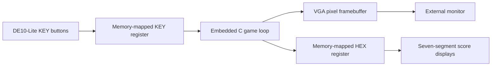

# Embedded Snake — DE10-Lite

**A playable Snake game written in embedded C and demonstrated on an FPGA-based DE10-Lite system, using memory-mapped VGA, pushbutton inputs, and seven-segment displays.**

`Embedded C` · `DE10-Lite` · `Nios V environment` · `Memory-mapped I/O` · `RGB565` · `VGA framebuffer`

## Overview

I programmed Snake to run on the DE10-Lite's processor-based lab setup and render directly to a VGA display. Instead of using a desktop graphics library or keyboard event API, the program **reads physical pushbuttons and writes to memory-mapped peripheral addresses**.

The game includes a moving snake, randomly positioned food, fixed obstacles, collision detection, progressive growth and speed, current/high-score tracking, and distinct win/loss screens.

> **Demo:** I recorded the game running on the lab monitor, including gameplay and the red game-over display. Selected video stills and a short highlight clip are being prepared for this repository.

## How the hardware and software interact



The program accesses hardware registers through `volatile` pointers, so reads and writes interact with the configured peripheral hardware rather than ordinary application variables.

```c
volatile pixel_t *pVGA = (pixel_t *)FPGA_PIXEL_BUF_BASE;
volatile int *pKEY = (int *)KEY_BASE;
volatile int *pHEX = (int *)HEX3_HEX0_BASE;
```

## Features and implementation

| Feature | Implementation |
| --- | --- |
| **Direct VGA rendering** | Draws pixels by writing RGB565 values into the pixel buffer |
| **Physical controls** | Detects falling-edge button presses to turn the snake left or right |
| **Snake tracking** | Two integer arrays store the `x` and `y` positions of each segment |
| **Collision detection** | Checks the screen boundaries, fixed obstacles, and snake body |
| **Food generation** | Random coordinates are regenerated if occupied by the snake or obstacles |
| **Game difficulty** | Movement speeds up after food is eaten; growth behaviour changes as the game progresses |
| **Score display** | Drives current score and retained high score through seven-segment encodings |
| **End states** | Displays a red game-over screen on collision and a green flashing win screen at score 9 |

### 1. VGA framebuffer and RGB565

Each pixel is a 16-bit `pixel_t`. The code uses **RGB565** values for black, white, red, green, and blue. The pixel address is computed from a row offset and column:

```c
void drawPixel(int y, int x, pixel_t colour)
{
    *(pVGA + (y << YSHIFT) + x) = colour;
}
```

A small `rect()` routine draws the playfield, borders, obstacles, and game-over screen without a graphics library.

### 2. Physical pushbutton controls

The game reads the KEY peripheral on each update and checks when a previously unpressed button transitions to pressed. Two buttons rotate the current direction clockwise or counterclockwise:

```c
if ((previousKeys & 1) != 0 && (keys & 1) == 0)
    direction = (direction + 3) % 4;
else if ((previousKeys & 2) != 0 && (keys & 2) == 0)
    direction = (direction + 1) % 4;
```

This means the player controls turns with the FPGA board's buttons, rather than using a PC keyboard.

### 3. Movement, collision, and scoring

The snake body is tracked by parallel arrays of pixel coordinates. Depending on growth state, the loop erases the old tail or extends the body, then draws the new head. Before doing so, it checks for collisions with the display boundaries, vertical obstacles, and existing body segments.

The game keeps track of the current score and a high score between rounds. Eating food increases the score and adjusts speed and growth. The physical HEX display is controlled by writing precomputed seven-segment patterns to a peripheral register.

## Source code

- **[src/snake.c](src/snake.c)** — original embedded C program supplied by the project author, preserved as written

### Build environment / reproducibility

This is **hardware-specific source**, not a desktop game. To compile and run it, the development environment must provide:

- An FPGA/processor configuration with VGA pixel buffer, KEY buttons, and HEX display peripherals
- The board support header `address_map_niosv.h`
- Address and geometry definitions including `FPGA_PIXEL_BUF_BASE`, `KEY_BASE`, `HEX3_HEX0_BASE`, `MAX_X`, `MAX_Y`, and `YSHIFT`
- A suitable Nios V software build/upload workflow for the configured lab system

Those board-specific support files are **not included** here; this repository contains the original application source and explanation, rather than a standalone, one-command build. The video documents the program operating in the configured university lab environment.

## Engineering takeaways

- **Hardware-software interfaces:** Accessing peripheral registers directly teaches how C programs interact with digital hardware
- **Rendering under constraints:** Updating a framebuffer and tracking pixel positions requires attention to memory layout and display timing
- **State-based input:** Button edge detection matters when a physical switch is held down for several game-loop iterations
- **Debugging on hardware:** Testing the full loop means checking input, frame rendering, collision rules, and physical display output together

## Future improvements

- Add reproducible board setup instructions and support-file configuration where distribution is permitted
- Separate hardware access from game logic to make the gameplay testable on a desktop
- Improve timing by replacing busy-wait delays with a timer peripheral
- Add more robust score handling and additional difficulty modes

---

*Personal embedded-systems coursework project · 2026*
